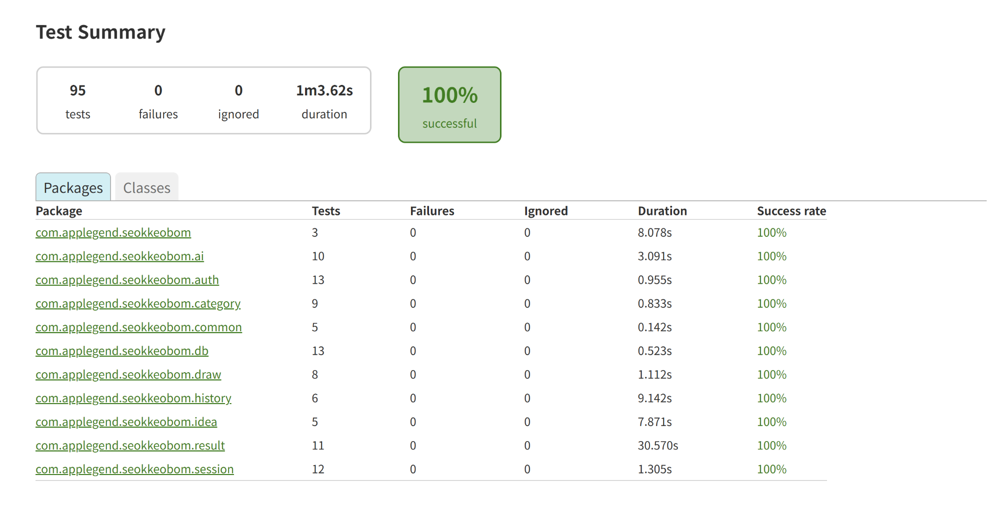

# seokkeobom-api

[](https://github.com/App-Legend/treeplan-backend/actions/workflows/deploy.yml)
[](https://github.com/App-Legend/treeplan-backend/actions/workflows/dev-registry.yml)

Treeplan 백엔드 (Spring Boot 3.5, Java 21). 프론트엔드는 별도 레포로 분리되어 있다.

## 로컬 실행

1. PostgreSQL 준비 (기본값: `localhost:5433/seokkeobom`, 계정 `seokkeobom` / `seokkeobom`)
2. 레포 최상위에 `.env` 를 두면 자동으로 읽는다 (git 제외). 환경변수가 있으면 그쪽이 우선.

   ```properties
   DB_URL=jdbc:postgresql://localhost:5433/seokkeobom
   DB_USERNAME=seokkeobom
   DB_PASSWORD=seokkeobom
   JWT_SECRET=32바이트-이상의-비밀값
   GEMINI_API_KEY=        # 비우면 예시(mock) 모드
   CORS_ORIGINS=http://localhost:5173
   ```

3. 실행

   ```bash
   ./gradlew bootRun
   ```

   API 는 `http://localhost:8080/api` 아래에 열린다. 상태 확인: `GET /api/actuator/health`

## 테스트

```bash
./gradlew test          # 전체
./gradlew testSmall     # 스프링·DB 없이 (설정, 가짜 DataSource)
./gradlew testMedium    # 스프링 + 테스트 DB, 한 프로세스
./gradlew testLarge     # 실제 포트 + Docker MySQL 8 (Docker 없으면 건너뜀)
```

PR 과 push 마다 GitHub Actions 가 PostgreSQL 위에서 테스트를 돌리고, 결과 리포트를 실행 화면의 Artifacts(`test-reports`, `dev-test-reports`)에 남긴다.
DB 연결 테스트는 TDD 로 만들었다 (RED 커밋 → CI 실패 → GREEN 커밋 → CI 통과, PR #6).

### 최근 테스트 결과

**95개 테스트, 실패 0, 건너뜀 0 — 성공률 100%** (전체 1분 4초)

| 패키지 | 테스트 | 실패 | 성공률 |
| --- | ---: | ---: | ---: |
| `seokkeobom` (전체 흐름) | 3 | 0 | 100% |
| `ai` | 10 | 0 | 100% |
| `auth` | 13 | 0 | 100% |
| `category` | 9 | 0 | 100% |
| `common` (헬스체크) | 5 | 0 | 100% |
| `db` (DB 연결 Small·Medium·Large) | 13 | 0 | 100% |
| `draw` | 8 | 0 | 100% |
| `history` | 6 | 0 | 100% |
| `idea` | 5 | 0 | 100% |
| `result` | 11 | 0 | 100% |
| `session` | 12 | 0 | 100% |



## 배포

`main` 에 push 하면 GitHub Actions (`.github/workflows/deploy.yml`) 가 테스트 후 이미지를 ECR 에 올린다.
